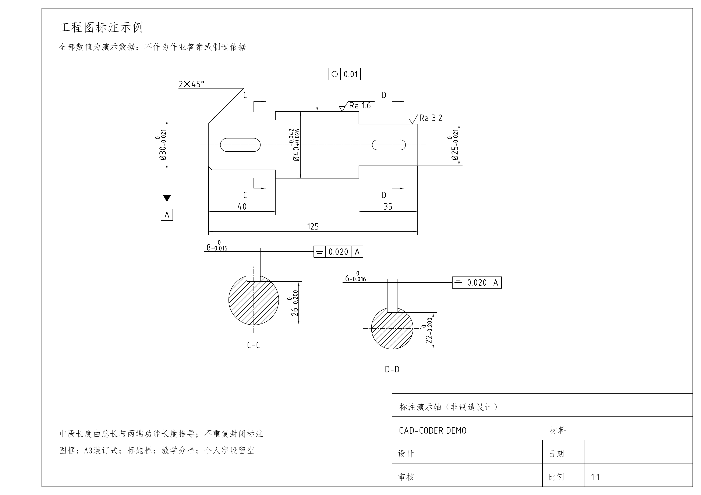

# CAD-Coder Skill · 机械零件工程图加强版

## 二次开发声明 / Attribution

本仓库是 [alexzeng2014/cad-coder-skill](https://github.com/alexzeng2014/cad-coder-skill) 的二次开发版本，原作者为 **alexzeng2014**，本次改进由 **kpdx-del** 维护。保留原项目的 MIT 许可证、作者署名及上游历史。本项目不代表原作者或论文作者的官方版本。

上游提供了"自然语言 → Python ezdxf 脚本 → 可编辑 DXF → 图片预览"的技能、零件模板和辅助函数。本次二次开发增加机械图样标注规则、改进辅助函数、提供可运行示例和回归测试。原始版权与本次修改版权见 [LICENSE](LICENSE)。

上游说明其设计受到论文 [CAD-Coder: Text-Guided CAD Files Code Generation](https://arxiv.org/abs/2505.08686) 启发。本仓库提供代理技能及 Python 绘图工具，不包含论文模型权重或训练数据。



示例为合成的标注演示（`examples/engineering_annotations.py` 生成），数值用于说明布局；不包含个人姓名、学号或课程原文件。

## 本次改进（均已实现并有测试覆盖）

- **毫米与真实尺寸倍率 1**：`new_doc()` 设置 `$INSUNITS=4`、`CAD_MM` 标注样式（`dimlfac=1`、小数点而非逗号），修正上游默认样式把 35 mm 显示成 3500 的单位/倍率问题。
- **GB/T 17450 风格图层与线宽**：粗实线 0.50 mm（图层 0），细实线/中心线/虚线/标注/剖面线 0.25 mm（THIN、CENTER、HIDDEN、DIM、HATCH）。
- **原生 DIMENSION 实体**：线性、直径、半径和三点角度尺寸。角度尺寸使用 ezdxf 1.4.x 原生渲染器（旧版 ZeroDivisionError 已修复，实测验证），始终测量小于 180° 的角。
- **上下偏差按带符号数值输入**：`dim_linear(..., upper=0.042, lower=0.026)` 表示两个正偏差，`upper=0, lower=-0.180` 表示零上偏差、负下偏差；原生公差堆叠显示，上下限必须同时提供，上限小于下限直接报错。
- **数字外置时箭身在外、箭头向内**：渲染前通过尺寸渲染器控制，尺寸线与外侧尾线同步生成，兼顾端点反向输入。保留原生 DIMENSION、尺寸块和箭头翻转属性。
- **引出线优先直线或一次转折**：`leader(..., elbow=...)`，LEADER 顶点从箭头尖端开始。
- **倒角标注共线校验**：`chamfer_note(..., chamfer_edge=(p1,p2))` 验证箭头段与真实倒角线延长线共线、方向朝外、目标点在棱边端点或延长线上、末段水平，违反即报错。
- **几何公差框**：`feature_control_frame` 支持对称度、圆柱度、圆跳动、平面度；引出线固定连接框左边中点、末段水平；关联导出轴线/中心平面时 `arrow=False` 用无箭头尺寸界线延伸连接。框为可编辑线/文字，不是原生 TOLERANCE 实体。
- **实心基准三角形**：`datum_symbol` 底边贴合边界、顶点朝外连接方框字母，SOLID 填充。需要在共用位置去掉普通尺寸箭头时，给 `dim_linear(..., suppress_arrow=1/2)` 传端号：渲染前用原生 `DIMSAH + DIMBLK=NONE` 把该端置空，尺寸线仍画到该点，不留箭头长缺口（写入 DXF 的真实数据，CAD 可识别，而非渲染后删块）。
- **渲染后几何审计**：`audit_annotations(msp)` 逐个核对每个 DIMENSION 有两个箭头块引用、尺寸线完整到达各端，以及每个 LEADER 的箭头标志能解析到真实箭头；返回问题清单（空列表即通过）。示例在构建后强制审计，箭头缺失或直线不完整会直接报错而不是混进预览。
- **完整粗糙度符号**：`roughness_symbol` 去除材料横杠符号，长边横杠上方注 Ra，支持旋转。
- **PNG/PDF 黑白预览**：`render_dxf.py --paper A3/A4 --scale`，固定纸张与比例（1:1、1:2…），按边距校验，超出纸张直接报错而非无提示缩放；`--font` 覆盖预览字体。预览文字采用 OUTLINE（矢量线框）策略：ezdxf 1.4.x 的 FILLING 策略会把直径符号 ⌀ 渲染成半填充怪字形，OUTLINE 可正确显示全部符号；DXF 文件本身保留正常文字，CAD 软件打开不受影响。
- **40 项回归测试**：数值与偏差符号、箭头实体方向、连接点几何、表面公差垂直引出、`suppress_arrow` 置空后尺寸线仍完整、审计能抓出缺失箭头与缩短的尺寸线、DXF 保存后重读、模板单位、PDF 实际纸张尺寸（MediaBox）、超界报错、字体覆盖。

## 安装与运行

Python 3.10+：

```bash
python -m pip install -r requirements.txt
python examples/engineering_annotations.py out
```

输出 `out/engineering_annotations.dxf`、`.png` 和 `.pdf`（A4，1:1）。DXF 中尺寸保留为 DIMENSION，引出线保留为 LEADER；公差框、基准与粗糙度由可编辑的线、文字和填充组成。

生成基础零件：

```bash
python scripts/part_templates.py flange out/flange.dxf
python scripts/render_dxf.py out/flange.dxf out/flange.png
python scripts/render_dxf.py out/flange.dxf out/flange.pdf --paper A3 --scale 1
```

`--scale 1` 表示 1:1，`--scale 0.5` 表示 1:2。固定纸张输出要求 DXF 单位为毫米。该选项只设置纸张和比例，不会自动画图框或标题栏。

中文图样需使用本机已安装且具有对应字形的字体：`new_doc(font="simhei.ttf")` 设置 DXF 字体；`render_dxf.py --font 字体路径.ttf` 仅覆盖预览字体。仓库不分发字体文件。

## 作为技能使用

将仓库目录安装或复制为技能目录中的 `cad-coder` 文件夹，使 `SKILL.md` 位于该文件夹根目录。可提出：

> 画一个阶梯轴，带尺寸与上下偏差、公差框和粗糙度。引出线最多一次转折，公差框从左边中点接线，生成可编辑 DXF 和预览图。

具体工作规则、辅助函数和验收步骤见 [SKILL.md](SKILL.md)。示例见 [examples/engineering_annotations.py](examples/engineering_annotations.py)。

```python
import sys
sys.path.insert(0, "scripts")
from sketch_helpers import new_doc, dim_linear, feature_control_frame, chamfer_note

doc = new_doc()
m = doc.modelspace()
dim_linear(m, (0, 0), (35, 0), 12, upper=0.042, lower=0.026)
feature_control_frame(m, (45, -30), "circular_runout", 0.025, "A", target=(35, 0))
chamfer_note(m, (-14, 9), size=2, target=(0, 13), elbow=(-4, 9),
             chamfer_edge=((0, 13), (2, 15)))
doc.saveas("part.dxf")
```

`upper`、`lower` 都是带符号偏差，不是偏差绝对值。部分辅助函数的可选参数为仅关键字参数。

## 验证与范围

```bash
python -m unittest discover -s tests -v
```

本次发布复验环境：Windows / Python 3.12.14、ezdxf 1.4.5、matplotlib 3.10.3，全部 40 项测试通过。外置箭头扩展依赖 ezdxf 1.4.x 渲染接口，依赖范围限定 `<1.5`。

仍有以下边界：

- 提供 2D DXF，不直接输出原生 DWG 或 3D 参数模型。
- 不自动选择工程公差，不自动规划无碰撞引出线，不自动证明整张图符合全部 GB 标准；基准与粗糙度布局采用本例选用的 GB/教材表达约定，其他制图体系应按其规范调整。
- 公差框不是原生 TOLERANCE 对象；文字、线和图形可分别编辑。
- 尚未在 AutoCAD/CAXA 等应用中逐个验证打开及重新生成的结果。重新读入 DXF 后如需用本项目规则重新渲染，应重新设置本项目的尺寸渲染器。
- 基础零件模板属于示意起点，不能替代螺纹、强度和制造设计。

## Roadmap

- 标注碰撞检测与自动布局（当前需按 SKILL.md 规则人工/代理检查）。
- 更多几何公差特征：位置度、垂直度、平行度、同轴度等。
- 原生 TOLERANCE 实体选项。
- 图框与标题栏模板（GB/T 14689 幅面）。
- 在 AutoCAD/CAXA 中实测打开与重生成。

## 来源

原始技能：[alexzeng2014/cad-coder-skill](https://github.com/alexzeng2014/cad-coder-skill)。论文引用沿用上游提供的信息：

```bibtex
@misc{he2025cadcoder,
  title={CAD-Coder: Text-Guided CAD Files Code Generation},
  author={Changqi He and Shuhan Zhang and Liguo Zhang and Jiajun Miao},
  year={2025},
  eprint={2505.08686},
  archivePrefix={arXiv},
  primaryClass={cs.GR},
  url={https://arxiv.org/abs/2505.08686}
}
```

辅助函数依据适用版本的 [ezdxf 尺寸文档](https://ezdxf.readthedocs.io/en/stable/tutorials/dimension.html) 及其实现进行验证。代码与技能继续使用 [MIT License](LICENSE)；论文内容的权利归其作者。
