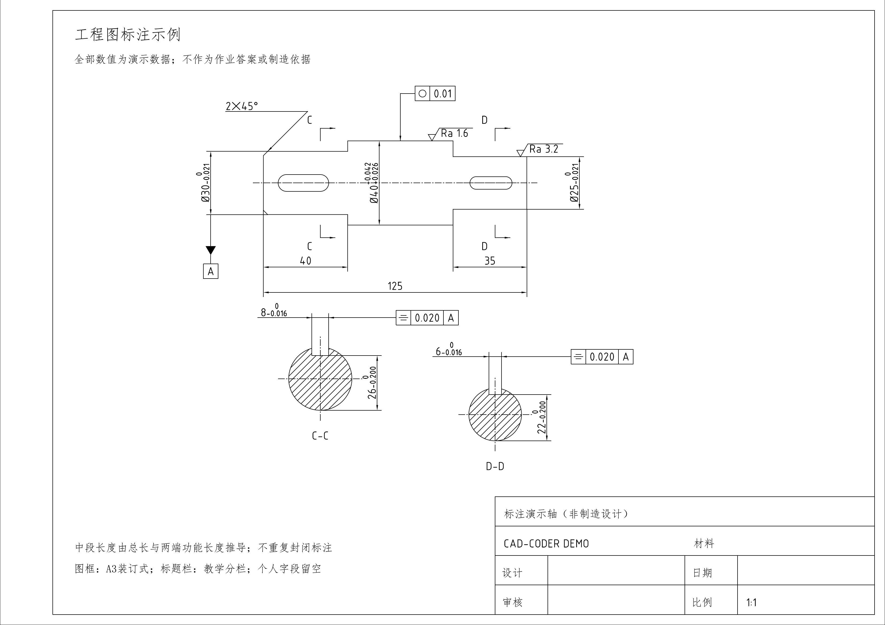

# CAD-Coder · 机械零件工程图加强版

本项目面向**机械专业本科生**，适合在机械制图、互换性与技术测量课程中练习零件图绘制和标注改错。可以从阶梯轴示例入手，对照教材检查配合尺寸、键槽和倒角，再用 CAD 编辑生成的 DXF。

维护者建议在 Codex 中优先选用 **GPT-6 Astra** 或 **GPT-6.1 Sol**。选模型时可先看[同一道阶梯轴题的三份图纸](benchmarks/codex-A1/compare.pdf)，再对照[测试条件与用量](benchmarks/codex-A1/README.md)。交作业前请放大检查槽宽数字、中心线和引出线，即使箭头检查通过，文字仍可能压线。

[查看维护者使用的全局 AGENTS.md](docs/author-rules/AGENTS.md)，了解参数来源、出图前澄清、发布前审图和错误复盘的约定。

本仓库是 [alexzeng2014/cad-coder-skill](https://github.com/alexzeng2014/cad-coder-skill) 的二次开发版本，由 **kpdx-del** 维护，保留上游作者署名与 [MIT许可证](LICENSE) 来源（含历史 generator 快照中的 MIT `cad_support` 副本）。本项目不代表上游作者或相关论文作者的官方版本。本地工作副本当前**不含 `.git` 目录**，因此不声称已保存或打包完整本地 Git 提交历史。

基于 Python + ezdxf，提供“读取条件 → 询问缺项 → 选择标注 → 生成可编辑DXF → 检查改错 → PNG/PDF验证”工作流。支持课程模式与指定标准版本的通用工程模式。数字默认采用直体工程字体 ISOCP，中文默认采用仿宋；个别示例（如紧固件画法对照）显式改用 Times，不附带字体文件。



**上图全部数值为自行编写的演示数据，不是用户课程作业答案或完整制造设计。** 图幅A3、1:1、装订式图框，标题栏采用教学分栏，个人信息留空。本轮交付见 [examples/review-20261127/](examples/review-20261127/)：可编辑[DXF](examples/review-20261127/engineering_annotations/engineering_annotations.dxf)、[PDF](examples/review-20261127/engineering_annotations/engineering_annotations.pdf)、[SVG](examples/review-20261127/engineering_annotations/engineering_annotations.svg)、[参数记录](examples/review-20261127/engineering_annotations/parameters.json)与[检查报告](examples/review-20261127/engineering_annotations/inspection.json)；紧固件画法对照见 [fastener_views/](examples/review-20261127/fastener_views/)。用[生成脚本](examples/engineering_annotations.py)或[紧固件示例](examples/fastener_views.py)重建。完整收口审阅见 [docs/closeout-review.md](docs/closeout-review.md)。

## 新增与修复

- 绘图前先读取已知信息，仅询问影响当前交付的缺项；区分必需、条件必需、可选和待确认设计建议。来源不足不能编造参数补成正式图，允许明确标记的已知内容草图。
- 六类专项询问/复核：轴、齿轮、轴承配合件、键/花键、螺纹、圆锥。本次不提供六套自动生成器，也不自动选材料、载荷、公差或配合。
- 六类二维零件候选索引（螺栓、螺母、垫圈、单列圆锥滚子轴承、平键、隔套）：`scripts/part_library.py` 提供 `list/search/show/check`，不加载 CAD 依赖、不下载、不自动选近似零件、不填制造参数；目录状态不等于尺寸表已核验，未核验尺寸不能标成正式尺寸库。
- ISOCP/仿宋显式样式与真实字宽测量，普通3.5 mm、偏差2.5 mm。字体缺失或字符不支持即报错。修复Ø错误填充，预览正常填充字形，ISOCP细轮廓按标注笔宽显示。
- 原生尺寸的文字/箭头独立选择；外置文字保持完整公称值及偏差，尺寸线延长到文字处。支持外置箭身朝内、教材内置箭头、反向端点与基准替代箭头。
- 倒角引线验证与真实倒角延长线共线；优先直线/一次转折。公差框默认左边中点连接，实际字宽定格宽；基准用贴边实心三角。
- 按教材第三章区分表面/导出要素连接、公共/有顺序基准、公差带前缀。剖面标注对准真正受控尺寸，避免槽深与槽宽混淆。
- 粗糙度采用所选课程版式：Ra在长横线下，方法在上，材料去除短横线不填实心三角。
- 尺寸关系检查可找出声明链中的重复独立约束与矛盾。保留功能尺寸，不自动删除最短环；公称值与极限区间分别计算。
- 整组布局与关联定位：C/D上下镜像、断面与对应剖切位置共线、名称居中，粗糙度避开剖切符号；检查文字与引线/轮廓、其他标注的线穿框和标题栏禁入。尺寸MTEXT存储真实堆叠宽度，文字整体位于水平线上方/竖直线左侧。
- 紧固件结构审图：`thread_end`/`hex_head_side` 将粗整圆与细3/4弧、外轮廓与两条投影面边以 XDATA 关联并随DXF保存；`audit_fasteners(msp)` 保存重开后能检出缺图元、粗/细角色（按有效线宽判断，实体覆盖优先、BYLAYER 取图层、BYBLOCK 走 review）、半径错误、弧角非约270°、sibling 互指断裂、重复角色、中心偏移、外轮廓未闭合或自相交、面边缺失/错位及关联断裂。只按传入 major/minor 校验，不推断产品规格；外来DXF不推断螺栓/螺母，缺关联旧图元仅提示人工复核。
- DXF/脚本/截图改错流程；结构化报告含问题、位置、依据和建议。可安全修字体到新副本，保留原文件与技术数值；复杂布局和技术含义仍需有依据地修改。

## 使用

Python 3.10+，本版接口按 ezdxf 1.4.5 验证：

```bash
python -m pip install -r requirements.txt
python examples/engineering_annotations.py out
python -m unittest discover -s tests -v
```

需要安装可使用的 ISOCP (`isocp___.ttf`) 和仿宋 (`simfang.ttf`)，或显式选择自己有权使用的字体，并检查字符覆盖。自定义字体目录通过 `CAD_FONT_DIRS` 指定（多个目录用系统路径分隔符）。没有字体就报告缺项，不用替代字体掩盖。模板默认值仅为合成示例。

将此仓库安装到Codex skills目录后，通过 `cad-coder` 绘图或改错。主入口是 [SKILL.md](SKILL.md)，按需读取：

- [询问、参数与来源](references/inputs.md)
- [通用标注规则](references/annotation-rules.md)
- [六类专项](references/parts.md)
- [二维零件库与六类候选索引](references/part-library.md)
- [检查、尺寸链与改错](references/checking.md)
- [来源索引与核实边界](references/sources.md)
- [CAD后端（FreeCAD二维Draft导入/保存重开等）](references/cad-backends.md)
- [协作方式与Codex分工](docs/collaboration.md)

输入预检 `validate_inputs`/`assert_ready`，结构化检查 `audit_drawing`，尺寸链 `check_dimension_chain`，差值区间 `derive_difference`；既有 `audit_annotations` 仍返回字符串列表。原有辅助函数保留，新增参数均为关键字参数。

```bash
python scripts/drawing_checks.py part.dxf --spec parameters.json --report report.json
python scripts/repair_dxf.py original.dxf revised.dxf --report changes.json
python scripts/render_dxf.py part.dxf part.png
python scripts/render_dxf.py part.dxf part.pdf --paper A3 --scale 1
```

修复输出必须为未占用的新路径。repair_dxf仅自动处理字体样式；报告仍有问题时不能称全部改错完成。源截图只用于诊断，缺少尺寸时不能据比例重建。

`--scale 0.5` 表示1:2，图幅溢出明确报错。sheet.py可画A3/A4横向装订式图框和180×56教学标题栏；固定纸张选项本身不自动画图框。已有整张图框覆盖幅面时使用 `--margin 0`，普通局部图默认10 mm页边距。

## 验证与边界

行为测试覆盖参数不足、来源追溯、未确认建议、真实字宽、内外箭头、反向端点、共享箭头、断线、长框格、教材表3-3的连接错误、尺寸链、极限区间、修订副本保护及PDF实际图幅。另执行示例，重新读取DXF并检查整图/局部。

已实测历史记录（本轮未重跑，见 `.local/closeout-input/` 只读日志）：Codex 独立运行 154 项 `unittest` 全部通过、紧固件 41 项变异/几何保持独立验收通过、零件库 18 项黑盒/语义独立验收通过。本轮收口 Codex 另独立运行 skill `quick_validate` 通过，并独立渲染三份 PDF 目视核验（页幅分别 A3/A4/A3），源图哈希未变；新工程示例 10 尺寸 20 箭头端、整机 9 尺寸 18 箭头端检查通过。收口明细见 [docs/closeout-review.md](docs/closeout-review.md)。

自动检查覆盖有明确特征关联的部分语义、文字/线碰撞以及已声明的布局关系；**不能验证任意DXF的全部技术含义、所有特殊图线或所有标准条文**。外来文件无关联信息时报告需复核。公差框为可编辑线/文字，不是原生TOLERANCE；未在特定CAD软件中编辑验证，不声称该软件兼容性已验证。本项目输出DXF，不是原生DWG。

尚未完成（如实保留，不自测代替用户认可）：六类候选索引的正式尺寸表未核验、不是六套自动生成器；不能杜绝任意漏箭头/图元重叠；FreeCAD二维Draft导入/保存重开已验证但 GUI 手工编辑及 SolidWorks 2023 原生草图/特征树未验证；工作副本未同步安装版、未发布。欢迎提供批评与可复现样例/数据集（含真实 DXF/位图与预期检查结果）。

课程教材只用于本地核对，仓库不附教材/课件原件。教材例图中的参数不能套入其他零件，旧标准版式与现行标准的适用性须区分。项目默认画法不等于唯一合法画法。

## 当前审阅入口

- [三组 Codex 同题测试、用量与匿名 PDF](benchmarks/codex-A1/README.md)
- [CASE-A1 标注避让修订示例](examples/CASE-A1-layout-fix/)
- [完整减速箱修订 06](replicas/revision-06/)（使用仓库根目录的 replicas；docs/replicas 为历史上传副本）
- [工程标注与紧固件示例](examples/review-20261127/)
